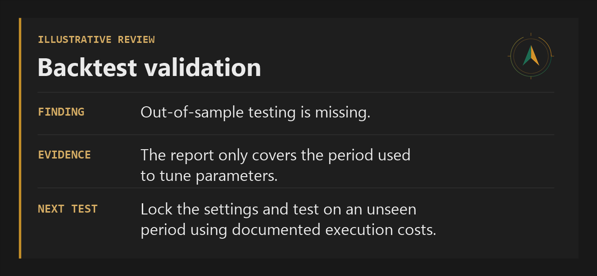

# Swift Ascent Trading Analysis Hub

A toolkit for auditing MetaTrader backtests. Trace findings to the tester report, record missing evidence, and define the next test. The Hub also includes specialist review prompts and workflows for trading strategies and Expert Advisor (EA) development.

**[Read a real MT5 report review](examples/mt5%20tester%20report%20case.md)** · [Audit a backtest](workflows/ea%20backtest%20review%20workflow.md) · [Browse personas](personas/)

## How to use

Choose a workflow, copy its prompt into your AI assistant, and add your strategy rules, EA specification, or backtest report. For a backtest review, include the test period, settings, trade count, and execution costs when available.

| If you want to… | Start here | What to bring |
| --- | --- | --- |
| **Review a strategy** | [Full strategy review](workflows/full%20strategy%20review%20workflow.md) | Entry and exit rules, market and timeframe, and exposure limits |
| **Audit a backtest** | [EA backtest review](workflows/ea%20backtest%20review%20workflow.md) | Tester report, optimization and holdout details, parameter settings, and execution assumptions |
| **Develop an Expert Advisor** | [EA development and validation workflow](workflows/institutional%20grade%20ea%20development%20workflow.md) | Strategy specification, target platform, and validation criteria |

## Sample backtest review

Read the [annotated review of a real MT5 report](examples/mt5%20tester%20report%20case.md), try the [fictional worked example](examples/worked%20backtest%20review.md), or see the [checklist vs. personas pilot results](examples/backtest%20review%20pilot%20results.md).

## Purpose

Use the Hub to review a trading idea from several angles before it becomes a live system. The personas cover quantitative performance, statistics, risk and portfolio exposure, market regime, documentation, trading context, pattern analysis, hedging, platform efficiency, and robust backtest validation.

## Repository structure

| Folder | Contents |
| --- | --- |
| [Personas](personas/) | Ten specialist roles for reviewing strategies, reports, and EA logic |
| [Skills](skills/) | EA Creator, source mapping, strategy rule conversion, and validation and rejection |
| [Templates](templates/) | Reusable forms for strategy documentation, backtest reviews, and quant audits |
| [Workflows](workflows/) | Multi-step reviews for strategies, backtests, documentation, and EA development |
| [Examples](examples/) | A [copyable prompt](examples/example%20prompt.md), annotated reviews, and a repeatable comparison |

## Best use cases

- Translate a discretionary strategy into explicit rules, then review the conditions, exceptions, and exposure controls.
- Check whether backtest evidence supports the conclusion. Review sample size, drawdown, execution assumptions, and robustness across test periods.
- Review hedge behavior, platform fit, and code efficiency before implementing or refactoring an EA. Specify whether the target is MetaTrader 4 or MetaTrader 5.
- Give reviewers a consistent format for documenting a strategy, a test result, or an implementation decision.

## Recommended EA development order

1. Map source material with the Source Knowledge Map, audit the documentation, and convert the strategy into explicit rules.
2. Review the regime, market patterns, trading assumptions, hedging, and exposure with the relevant personas.
3. Use the EA Creator Skill and EA Platform and Code Efficiency Advisor to define platform requirements and prepare the implementation.
4. Review performance and statistical reliability, run robustness checks, and apply the Risk and Portfolio Analyst and Validation and Rejection Skill before deployment.

Follow the [complete EA development workflow](workflows/institutional%20grade%20ea%20development%20workflow.md) for the full sequence.

## Core principle

Check clear rules, sufficient trades, stable performance, drawdown, realistic execution, and the target platform together. Use out-of-sample, walk-forward, and Monte Carlo checks where appropriate for the strategy and data.

## Important note

These resources support structured analysis and validation. They do not guarantee profitable trading. The review above is illustrative.

## License

[MIT](LICENSE)
